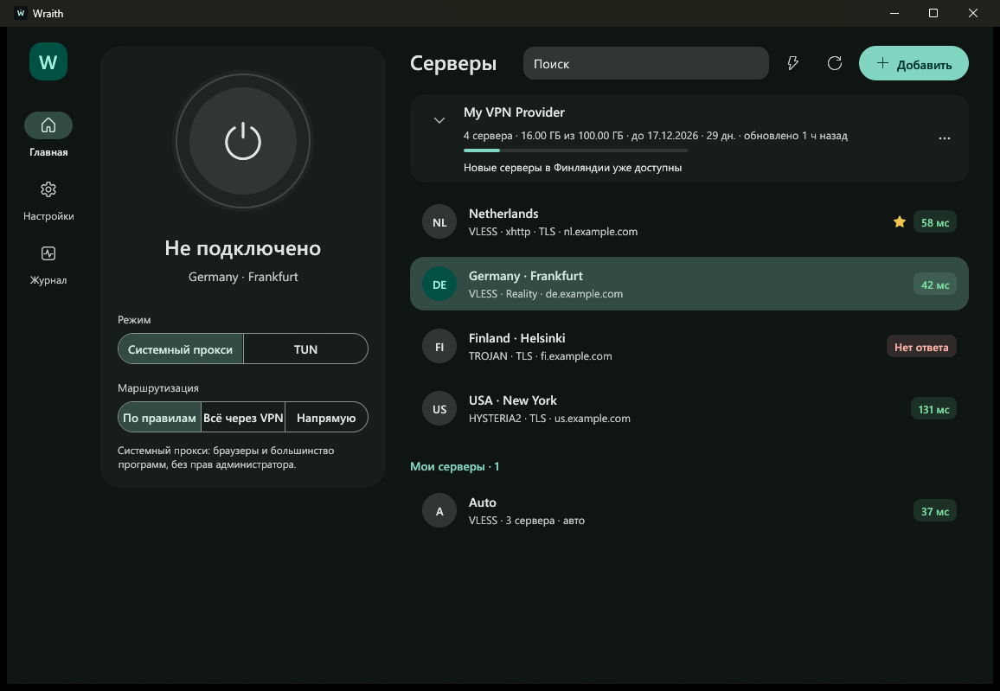
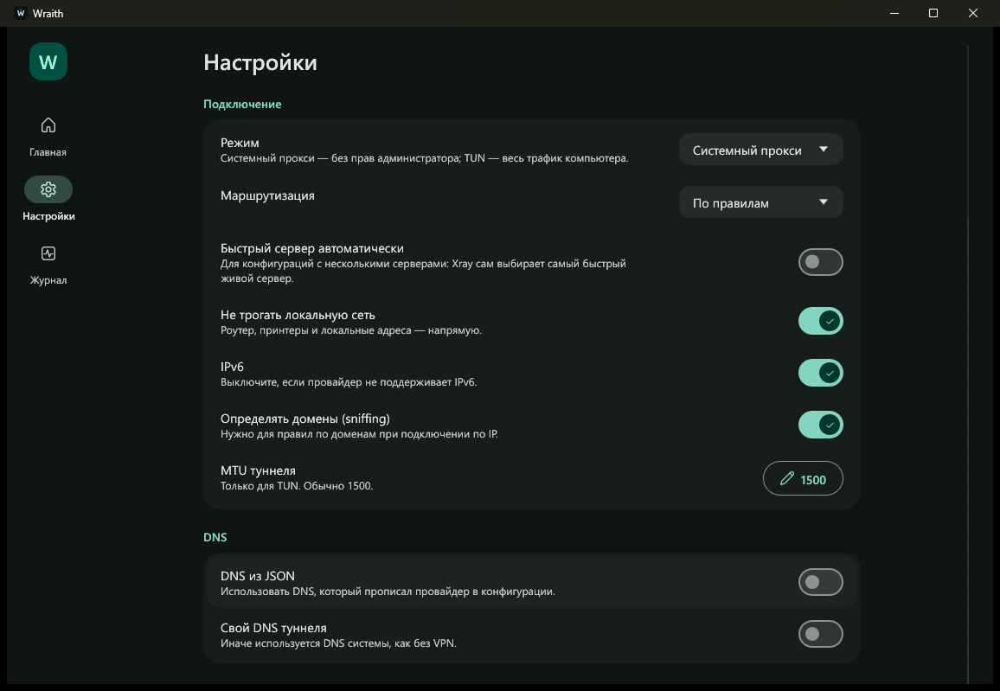

# Wraith for Windows

Native Windows VPN client in Rust (egui) for VLESS / VMess / Trojan / Shadowsocks / Hysteria2 / TUIC / AnyTLS / WireGuard, with two cores: **Xray** and **sing-box**. This is the Windows edition of [Wraith for Android](https://github.com/trinity13338/wraith).

> Русский: Wraith для Windows — нативный клиент на Rust с ядрами Xray и sing-box. Он понимает подписки (с заголовками Happ), JSON Xray и sing-box, авто-конфиги с балансировщиками. Работает в режимах системного прокси и TUN, в стиле Material 3.

<p>


</p>

## Download

Get the latest [release](https://github.com/trinity13338/Wraith-windows/releases/latest):

- **`Wraith-Setup-*.exe`** — the installer.
  - Installs into `Program Files`, where only administrators can write.
  - Creates a Task Scheduler task with highest privileges. Wraith then starts elevated without a UAC prompt each time, which TUN needs; autostart at logon uses the same mechanism.
  - Uninstall from Settings → Apps.
- **`Wraith-Windows-*-x64.zip`** — the portable build. Unpack it and run `Wraith.exe`.

## Features

- **Import.** Share links, HTTPS subscriptions with Happ headers (usage, expiry, announce, routing profile), and full Xray and sing-box JSON, including multi-server configs with balancers (`leastPing` + `observatory`).
- **Two cores**, chosen on the home screen. A server the selected core cannot run uses the other one automatically.
- **System proxy and TUN** as independent switches; both are on by default. In TUN mode, routing rules can match programs (`.exe`).
- **Latency checks through the proxy.**
  - Every server of an auto config is checked, and the best result counts.
  - Keep-alive mode measures the server round trip without the handshake.
  - TCP and ICMP checks are available too.
- **DNS** is the system's by default. The provider's DNS from JSON and your own DoH/DoT address are opt-in. IP addresses: Auto / IPv4 / IPv6.
- **Interface.** Tray icon, autostart, Material 3 look with light and dark themes. Settings are encrypted with DPAPI.
- **Security.**
  - The Xray config is passed through stdin, so no runtime config file can be swapped while Wraith runs elevated.
  - Updates come from GitHub Releases. They are verified by SHA-256 and unpacked in memory.
  - Imported configs cannot open their own API listeners or services, and cannot write log or cache files.
  - The local proxy is reachable from the LAN only with a password.

## Building

You need Rust stable with the MSVC toolchain (Windows 10/11).

```sh
cargo build --release
```

Put the following next to `target/release/Wraith.exe`:

- `xray.exe`, `geoip.dat` and `geosite.dat` from the [Xray-core release](https://github.com/XTLS/Xray-core/releases);
- `sing-box.exe`, built from sing-box 1.14.1 with `third_party/wraith-core/apply.sh` (tags `with_gvisor,with_quic,with_wireguard,with_utls,with_clash_api`);
- `wintun.dll` from [wintun.net](https://www.wintun.net).

The installer is the same program built with `--features setup`. The release zip is embedded through the `WRAITH_PAYLOAD` environment variable:

```sh
WRAITH_PAYLOAD=path/to/Wraith-Windows-x64.zip cargo build --release --features setup --target-dir target/setup
```

Tests: `cargo test`. They validate generated configs with the real cores when those cores are found in `../.tools`. `cargo test -- --ignored` adds end-to-end checks through a local Xray server.

## License

GPL-3.0-or-later (see [LICENSE](LICENSE)). Third-party components: [THIRD_PARTY_NOTICES.md](THIRD_PARTY_NOTICES.md).
