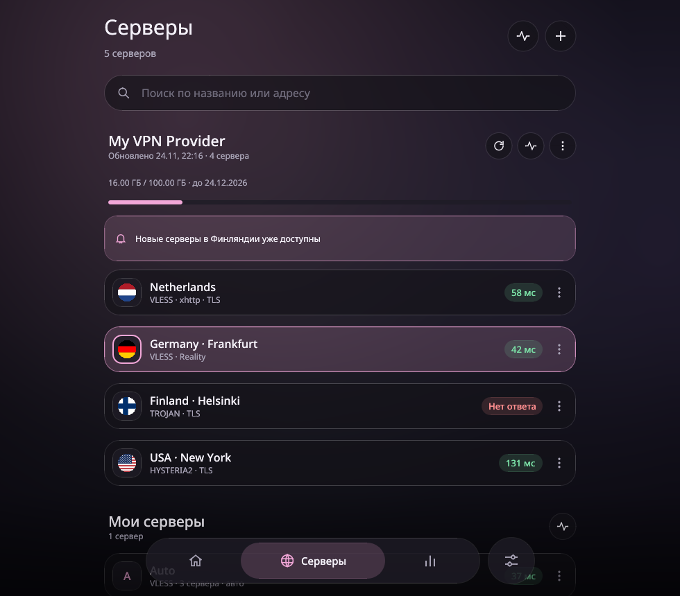
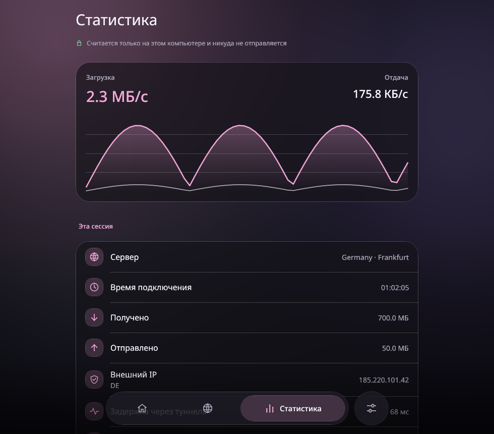
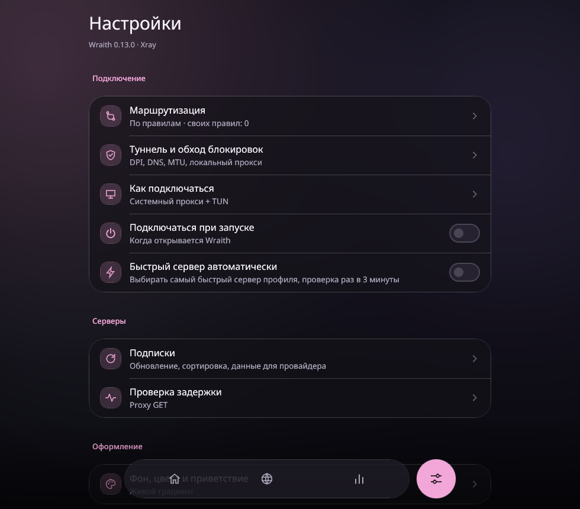

# Wraith for Windows

Native Windows VPN client in Rust (egui) for VLESS / VMess / Trojan / Shadowsocks / Hysteria2 / WireGuard on **Xray-core**. This is the Windows edition of [Wraith for Android](https://github.com/trinity13338/Wraith-android).

> Русский: Wraith для Windows — нативный клиент на Rust на ядре Xray. Он понимает подписки (с заголовками Happ), JSON Xray и авто-конфиги с балансировщиками. Язык интерфейса — русский или английский, по языку системы. Работает в режимах системного прокси и TUN. С версии 0.13 интерфейс и возможности перенесены из Wraith для Android: живой фон или своё фото, акцентные цвета (в том числе акцент Windows), приветствие, внешний IP и задержка через туннель, статистика по дням, которая никуда не отправляется.

<p>




</p>

## Download

Get the latest [release](https://github.com/trinity13338/Wraith-windows/releases/latest):

- **`Wraith-Setup-*.exe`** — the installer.
  - Installs into `Program Files`, where only administrators can write.
  - Creates a Task Scheduler task with highest privileges. Wraith then starts elevated without a UAC prompt each time, which TUN needs; autostart at logon uses the same mechanism.
  - Uninstall from Settings → Apps.
- **`Wraith-Windows-*-x64.zip`** — the portable build. Unpack it and run `Wraith.exe`.

## Features

- **The Android app's interface (0.13).**
  - Your own photo as the background (blur and dimming), or a live gradient that reacts to the connection.
  - Accent colours: presets, the colour of your photo, or the Windows accent colour.
  - A greeting, live stats in a fixed grid (time, exit IP, delay through the tunnel, speed), a connect button with packets running through it at the speed of the traffic, and a floating tab bar: Home, Servers, Statistics, Settings.
- **Statistics that stay on the computer.** Live speed chart, this session, and daily totals for the last 14 days in `traffic.json`. Nothing is uploaded.
- **Servers.** Flags, latency chips, favourites, subscription usage and expiry notices; edit a server's link or JSON, view its configuration, run diagnostics (the core checks the config).
- **Backup.** Export servers, subscriptions, rules and settings to a JSON file and restore them.
- **Import.** Share links, HTTPS subscriptions with Happ headers (usage, expiry, announce, routing profile), and full Xray JSON, including multi-server configs with balancers (`leastPing` + `observatory`).
- **Russian or English** interface, picked from the Windows display language.
- **System proxy and TUN** as independent switches; both are on by default. In TUN mode, routing rules can match programs (`.exe`).
- **Latency checks through the proxy.**
  - Every server of an auto config is checked, and the best result counts.
  - Keep-alive mode measures the server round trip without the handshake.
  - TCP and ICMP checks are available too.
- **DNS** is the system's by default. The provider's DNS from JSON and your own DoH/DoT address are opt-in. IP addresses: Auto / IPv4 / IPv6. QUIC (UDP 443) can be blocked so browsers fall back to TCP.
- **Subscriptions** update in the background once their interval has passed (checked hourly), on start if you like, and can be pinged on start.
- **Desktop.** Tray icon, autostart, closing to the tray. Settings are encrypted with DPAPI.
- **Security.**
  - The Xray config is passed through stdin, so no runtime config file can be swapped while Wraith runs elevated.
  - Updates come from GitHub Releases. They are verified by SHA-256 and unpacked in memory.
  - Imported configs cannot open their own API listeners or services, and cannot write log or cache files.
  - The local proxy is reachable from the LAN only with a password.

## Building

You need Rust stable with the MSVC toolchain (Windows 10/11).

```sh
cargo build --release
```

Put the following next to `target/release/Wraith.exe`:

- `xray.exe`, `geoip.dat` and `geosite.dat` from the [Xray-core release](https://github.com/XTLS/Xray-core/releases);
- `wintun.dll` from [wintun.net](https://www.wintun.net).

The installer is the same program built with `--features setup`. The release zip is embedded through the `WRAITH_PAYLOAD` environment variable:

```sh
WRAITH_PAYLOAD=path/to/Wraith-Windows-x64.zip cargo build --release --features setup --target-dir target/setup
```

Tests: `cargo test`. `WRAITH_SHOTS=dir cargo test --release -- --ignored --test-threads=1 render_screens` draws every screen without a window into PNG files. They validate generated configs with the real cores when those cores are found in `../.tools`. `cargo test -- --ignored` adds end-to-end checks through a local Xray server.

## License

GPL-3.0-or-later (see [LICENSE](LICENSE)). Third-party components: [THIRD_PARTY_NOTICES.md](THIRD_PARTY_NOTICES.md).
